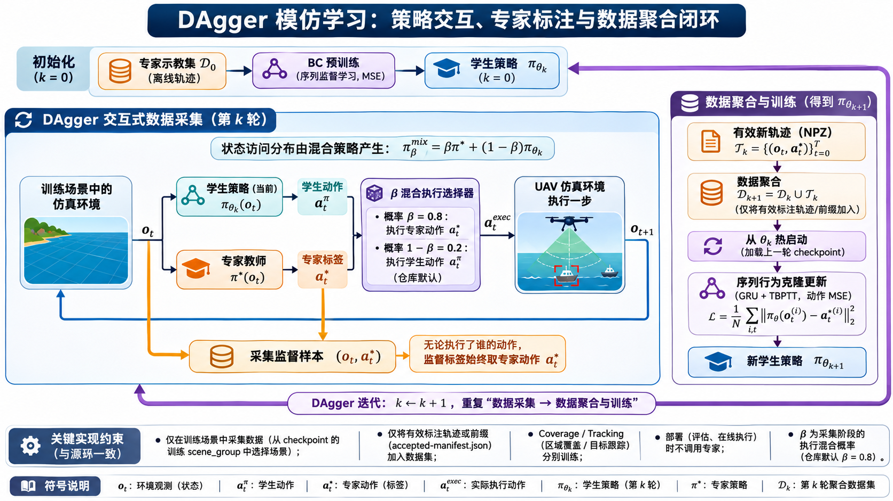

# Area Coverage and Target Tracking

基于智能体的多传感器联合调度仿真。一架固定翼无人机与一艘科考船在 **300 km × 300 km** 海域执行持续区域覆盖与移动目标跟踪，使用两套独立启发式专家、数据集及 CNN + GRU 行为克隆策略。项目提供 Gymnasium 环境、实时态势图、NPZ 历史回放、TensorBoard 指标和真实 MP4 演示录制。

## 功能

- **区域覆盖**：随机目标子区域、右侧扇形雷达扫描、首扫/重扫/信息年龄统计。
- **移动目标跟踪**：科考船沿航路绕岛，无人机以可偏转雷达持续观测。
- **局部引斥场**：场值色块与相邻栅格差分方向可独立显示，支持白色/深海蓝主题。
- **可复现实验**：权威采集清单、按场景组划分、训练集归一化、固定模型 SHA 和独立推理测试。
- **紧凑存储**：轨迹使用压缩 NPZ，服务端加载时转为前端 JSON，不重复保存完整轨迹 JSON。
- **批次指标**：每个训练/验证 mini-batch 完成后写入 TensorBoard，训练结束后每任务默认评估30回合。

雷云约束无人机，岛屿约束船舶；无人机可飞越岛屿。策略输入包含船舶真实状态，雷达可见性另行计算。有限时域测试不代表任意场景下的安全保证，训练误差也不等同于任务成功率。

## 算法

本项目采用带时序记忆的**行为克隆（Behavior Cloning，BC）**：先由启发式专家生成状态—动作示教序列，再用 CNN + MLP + GRU 学习控制策略，最后在真实运动学与雷达约束下闭环执行。区域覆盖和目标跟踪分别维护专家、数据集、策略参数及隐藏状态。

在初始 BC 训练后，可选使用 **DAgger（Dataset Aggregation，数据集聚合）**：让学生策略参与训练场景交互，由专家为访问到的状态提供动作标签，再聚合有效示教数据并更新策略。图1展示这一迭代过程，网络结构和优化目标见后文。



*图1：DAgger 交互采集与训练流程。采集阶段默认以0.8的概率执行专家动作、0.2的概率执行学生动作，监督标签始终取专家动作；有效新轨迹以 NPZ 保存并加入聚合数据集，再从上一轮策略参数继续训练。采集仅使用训练场景，评估与在线执行不调用专家。图中的 MSE 表示动作平方误差；代码中 `Loss` 与按动作分量平均的 `Action_MSE` 的关系见下文。*

### 任务目标与物理约束

覆盖任务关注有效海面上的首扫覆盖率和持续重访。令 $\mathcal{G}_{\mathrm{water}}$ 为排除岛屿后的有效栅格， $\tau_g$ 为栅格最近一次被实际雷达扫描的时刻，则：

$$
C(t)=\frac{1}{|\mathcal{G}_{\mathrm{water}}|}\sum_{g\in\mathcal{G}_{\mathrm{water}}}\mathbf{1}\lbrace\tau_g\geq 0\rbrace,
\qquad
\bar A(t)=\frac{1}{|\mathcal{G}_{\mathrm{water}}|}\sum_{g\in\mathcal{G}_{\mathrm{water}}} A_g(t).
$$

其中已扫描格的年龄 $A_g(t)=t-\tau_g$，未扫描格的年龄为 $t$。任务希望提高 $C(t)$、降低平均及最大扫描年龄；首次达到100%覆盖后仍继续重访。

跟踪任务希望目标始终位于真实雷达距离和扇形内。按物理更新步统计，可见比例为：

$$
Q_{\mathrm{track}}=\frac{1}{K}\sum_{k=1}^{K}
\mathbf{1}\left\lbrace d_k\leq R,\quad
\left|\operatorname{wrap}(\vartheta_k-\psi_k-\gamma_k)\right|\leq\alpha\right\rbrace.
$$

$K$ 为回合内物理更新步数， $d_k$ 为机船距离， $\vartheta_k$ 为目标方位， $\psi_k$ 为无人机航向， $\gamma_k$ 为雷达实际偏角， $R$ 和 $\alpha$ 分别为雷达距离与半角。任务目标为 $Q_{\mathrm{track}}=1$ 且全程无丢失，同时满足云区、岛屿、世界边界及平台操纵约束。这些是任务评估指标，网络参数通过后述示教损失优化。

### 专家示教与局部引斥场

两类专家仅使用与网络相同的公开观测。覆盖专家结合公共补扫目标、候选航向和雷达扇形收益安排扫描；跟踪专家利用船舶相对运动建立绕飞方向，并根据目标方位及其变化计算雷达指令。专家的有限时域物理预测负责筛查云区和边界风险。

局部场以无人机为中心，四个通道分别表示**偏好值、任务海面、硬约束和圆形有效范围**。覆盖任务中，对已经扫描过的海面格，年龄偏好采用归一化指数函数：

$$
P_{\mathrm{scan}}(a)=-1+2\frac{1-\exp(-\kappa\rho)}{1-\exp(-\kappa)},
\qquad \rho=\operatorname{clip}\left(\frac{a}{T_r},0,1\right).
$$

$a$ 为扫描年龄， $T_r$ 为重访周期， $\kappa\gt 0$ 控制增长速度。新近扫描时偏好为 $-1$，达到重访周期时为 $+1$，未扫描格直接取 $+1$；云区和越界区域另以硬约束通道标记。跟踪任务使用围绕移动目标的距离偏好。前端箭头表示场值差分方向，实际控制还结合绕飞目标、雷达收益和物理可行性。实现见 [potential_field.py](src/potential_field.py) 与 [expert_field.py](src/expert_field.py)。

### 多模态时序策略网络

下表对应当前 `obs-field-v2` 与正式脚本默认配置：

| 输入分支 | 观测内容与形状 | 编码特征 |
| --- | --- | --- |
| 物理向量 | `vector[111]`（覆盖）或 `vector[134]`（跟踪） | MLP → 128维 |
| 局部场 | `potential[4,33,33]` | CNN → 128维 |
| 场上下文 | `field_context[16]` | MLP → 64维 |
| 云几何增强 | 从公开云几何提取；默认仅覆盖启用 | 共享 MLP + 汇聚 → 64维 |

默认覆盖拼接384维特征、跟踪拼接320维特征，再送入隐藏维度为128的 GRU：

$$
z_t=\operatorname{Encode}_{\theta}(o_t),\qquad
h_t=\operatorname{GRU}_{\theta}(z_t,h_{t-1}),\qquad
\hat a_t=g_{\theta}(h_t,o_t)=(\hat u_{x,t},\hat u_{y,t},\hat p_t).
$$

方向与雷达头在当前观测导出的几何参考上学习残差，输出世界坐标系单位期望方向 $\lVert\hat{\boldsymbol u}_t\rVert_2=1$ 及归一化雷达指令 $\hat p_t\in[-1,1]$。正式配置在网络内部采用机体坐标编码，并默认屏蔽上一时刻方向命令；外部观测和输出仍采用世界坐标。实现见 [policy_field.py](src/policy_field.py)。

### 优化目标

示教数据由观测 $o_{it}$ 与专家指令 $a_{it}^{\ast}$ 组成，训练标签是专家请求的动作。设一个序列批次含 $B$ 个回合， $m_{it}\in\lbrace 0,1\rbrace$ 表示该位置是否为有效动作标签，则默认行为克隆数据损失为：

$$
\mathcal{L}_{\mathrm{BC}}(\theta)=
\frac{\sum_{i=1}^{B}\sum_t m_{it}\left\lVert\hat a_{it}-a^{\ast}_{it}\right\rVert_2^2}
{\sum_{i=1}^{B}\sum_t m_{it}}.
$$

Adam 根据该损失更新网络，并通过 `--weight-decay` 施加 L2 正则，对应优化目标：

$$
\theta^{\ast}=\arg\min_{\theta}\left[\mathcal{L}_{\mathrm{BC}}(\theta)
+\frac{\lambda_{\mathrm{wd}}}{2}\lVert\theta\rVert_2^2\right].
$$

动作包含世界 XY 方向与归一化雷达偏角三个分量。默认 `Loss` 对三个分量的平方误差求和，再对有效时间步平均；`Action_MSE` 再按三个动作分量平均，因此默认 `Action_MSE` 等于 $\mathcal{L}_{\mathrm{BC}}/3$。padding 不计入分子或分母，TensorBoard 的 `Loss` 不包含优化器的 L2 正则项。

启用专家纠正加权或倾斜辅助损失时，数据损失扩展为：

$$
\mathcal{L}_{\mathrm{train}}(\theta)=
\frac{\sum_{i,t}m_{it}w_{it}\left[\lVert\hat a_{it}-a^{\ast}_{it}\rVert_2^2
+\lambda_{\mathrm{steer}}\ell^{\mathrm{steer}}_{it}\right]}
{\sum_{i,t}m_{it}w_{it}}.
$$

当专家 XY 指令与观测中的上一条方向命令之差超过 `--correction-threshold` 时， $w_{it}$ 取 `--correction-weight-max`，否则为1；默认所有权重均为1。 $\ell^{\mathrm{steer}}$ 为针对专家请求倾斜的超额 BCE 辅助损失，扣除专家基线后取非负值，默认 $\lambda_{\mathrm{steer}}=0$。Adam 此时优化扩展数据损失加 L2 正则。纠正加权仅在训练更新时启用，基线与验证均取 $w_{it}=1$；开启倾斜辅助项时，验证 `Loss` 也包含该项，原始 `Action_MSE/MAE` 始终只统计未加权的动作误差。实现见 [train.py](src/train.py)。

### 从示教到闭环评估

1. **构建数据集**：随机初始化场景，由对应专家与环境交互；NPZ 保存完整观测和动作，权威清单仅纳入接受的示教回合。
2. **划分与训练**：按场景组划分训练/验证集，仅在训练集拟合归一化。采用序列 mini-batch 与 TBPTT，回合开始重置 GRU，连续分块间传递并 detach 隐藏状态；每个训练批次执行梯度裁剪与 Adam 更新，训练和无梯度验证批次分别写入指标。
3. **可选 DAgger**：仅在训练场景上让当前策略访问状态，由专家重新标注，并将接受的样本聚合回示教集。混合执行动作与专家标签分别保存，验证和最终测试场景保持独立。
4. **在线执行**：循环执行“当前观测 → 策略与隐藏状态 → 方向/雷达指令 → 物理推进 → 下一观测”。飞行方向经过有限倾斜响应，雷达偏角受转速限制；可选 `forecast` 安全层还会独立检查候选动作的有限时域物理可行性。
5. **独立评估**：训练/验证完成后固定 `last.pt` 的 SHA，每任务默认运行30个独立回合，保存实际轨迹及回合级结果。验证误差用于训练诊断，最终任务成功率单独统计，测试结果不参与权重选择。

## 安装

需要 Python 3.10+，Windows 推荐 Git Bash；GPU 训练需要与驱动匹配的 PyTorch。

```bash
git clone https://github.com/SuperExpertDoctor/Area-coverage-Target-tracking-by-BC.git
cd Area-coverage-Target-tracking-by-BC
python -m venv .venv
source .venv/bin/activate
# Windows Git Bash 改用：source .venv/Scripts/activate
python -m pip install -r requirements.txt
```

静态前端无需构建。自动浏览器录屏另需 Node.js 与 Playwright，优先复用本机 Chrome/Edge，也支持 Chromium：

```bash
npm install --no-save playwright
npx playwright install chromium
```

无需自动录像时追加 `--no-browser-recording`，仍可使用实时界面与历史回放。

## 快速开始

`run.sh` 集中声明仿真、采集、训练、评估和录像超参数，再调用 `main.py`；命令末尾参数覆盖默认值。

```bash
# 预检 → 采集 → 训练/验证 → 30回合独立评估 → 演示录屏
bash run.sh formal --experiment-name experiment-01

# 单任务；不自动打开浏览器，完成后退出服务
bash run.sh formal --task tracking --experiment-name tracking-01 \
  --no-open-browser --no-keep-server

# 查看已有实验
bash run.sh serve --experiment-name experiment-01
python -m tensorboard.main --logdir tf-logs/experiment-01 --host 127.0.0.1 --port 6006
```

前端默认 `http://127.0.0.1:8787/`，TensorBoard 默认 `http://127.0.0.1:6006/`。另开实验时指定空闲端口，例如 `--port 8788`。配置和目录调整仅对新启动进程生效，不迁移旧产物，不热更新当前算法。

### 分阶段运行

每次算法启动必须使用新实验名。分阶段运行时，通过清单和 checkpoint 显式引用前一步产物：

```bash
bash run.sh collect --task tracking --experiment-name demonstrations-01 --no-keep-server
# 训练/验证结束后也自动执行30回合独立评估
bash run.sh train --task tracking --experiment-name training-01 \
  --dataset-manifest outputs/demonstrations-01/datasets/tracking/accepted-manifest.json \
  --no-keep-server
# 在新的实验目录评估已有 last.pt
bash run.sh evaluate --task tracking --experiment-name evaluation-01 \
  --checkpoint-path outputs/training-01/weights/tracking/last.pt --no-keep-server
python main.py --help
```

`outputs/<experiment-name>` 或 `tf-logs/<experiment-name>` 任一已存在，程序在启动算法、写入配置和缓存前抛出 `FileExistsError`，即使目录为空也拒绝复用。两处均不存在时才预留目录；不提供续训入口。`serve` 可以查看已有实验，且不改写其运行配置。

`formal` 使用预先声明的完整协议。`formal/train/all/dagger` 最终测试固定 `last.pt`；`evaluate` 可用 `--checkpoint-path` 指定已有模型。固定 SHA 后才评估，测试结果不参与权重挑选。

`--closed-loop-selection` 额外使用验证场景比较 best/last，决定是否导出 `selected.pt`，与最终30回合测试分开；验证未通过时如实报告，独立推理结果另行保留。可用 `--no-closed-loop-selection` 关闭这项额外验证。

### 主要参数

| 参数 | run.sh 默认值 | 含义 |
| --- | --- | --- |
| `--experiment-name` | `formal` | outputs 与 tf-logs 下的实验子目录 |
| `--run-name` | `formal-1000` | 每任务 TensorBoard 运行子目录 |
| `--episodes` | `1000` | 每任务接受的示教回合数，失败尝试不计入 |
| `--collection-workers` | `8` | 示教采集进程数 |
| `--collection-replay-every` | `60` | 展示帧间隔，训练观测/动作仍逐决策步保存 |
| `--epochs` | `20` | 训练轮数 |
| `--batch-size` | `4` | 同时处理的训练序列数 |
| `--validation-batch-size` | `4` | 同时处理的验证序列数 |
| `--sequence-length` | `64` | 每个 TBPTT 分块的连续步数 |
| `--learning-rate` | `0.0003` | Adam 学习率 |
| `--validation-fraction` | `0.2` | 按场景组划分的验证比例 |
| `--device` / `--inference-device` | `auto` / `cpu` | 分别指定训练和推理设备 |
| `--eval-episodes` | `30` | 每任务独立评估回合数 |
| `--eval-seed` | `960000` | 覆盖测试起始种子，跟踪额外加10000 |
| `--eval-workers` | `4` | 独立评估进程数 |
| `--recording-duration-seconds` | `30` | 演示录像时长，默认1440×900、24FPS |

batch size=4、分块长度64是控制长轨迹解压内存与 CNN 激活规模的保守起点；内存/显存不足时先减小 batch size，再减小序列长度。最后不足一个批次的样本仍参与计算。正式脚本覆盖时长10800秒、跟踪1800秒，预检种子7100/7101，测试种子分别为960000–960029和970000–970029。

直接调用 `main.py` 的部分默认值比正式脚本小，以 `--help` 为准。`--eval-*` 兼容旧 `--formal-test-*` 参数。实验名支持中文，但必须是单个合法目录名，禁止路径分隔符、`.`、`..` 和 Windows 保留名称。`--output-dir`、`--tf-log-dir` 指定实验父目录；直接调用省略实验名保留旧路径规则，推荐显式指定。

## 实验目录

```text
outputs/
└── experiment-01/
    ├── datasets/                       # 示教数据，权威训练输入
    │   ├── preflight/                  # 专家预检 .npz
    │   ├── coverage/
    │   │   ├── episode-12000.npz
    │   │   ├── accepted-manifest.json  # 仅 paths 中接受的回合进入训练
    │   │   ├── .collection-attempts/    # 每次尝试的结果与校验证据
    │   │   └── failures/               # 小型错误说明 JSON
    │   └── tracking/
    ├── weights/                        # 模型及优化器 checkpoint
    │   ├── coverage/                   # best.pt、last.pt、coverage_policy.pt
    │   ├── tracking/                   # best.pt、last.pt、tracking_policy.pt
    │   └── frozen-latest/              # 按 SHA 固定的测试/录屏权重
    ├── logs/                           # 配置、状态、日志与缓存
    │   ├── run-config.json
    │   ├── configs/
    │   ├── formal-protocol.json         # formal 预先声明的协议
    │   ├── formal-status.json
    │   ├── formal-report.json
    │   ├── training/{coverage,tracking}/
    │   │   ├── training-status.json
    │   │   ├── history.json
    │   │   ├── dataset_split.json
    │   │   └── train_config.json
    │   ├── reports/                    # 分阶段运行汇总
    │   ├── recordings/                 # 前端 MP4 与来源 JSON
    │   ├── videos/                     # 可选离线导出
    │   └── cache/                      # 可再生运行缓存
    └── eval/
        ├── coverage/<mode>/
        │   ├── episode-960000.npz       # 每回合真实交互轨迹
        │   ├── episodes.json            # 逐回合结果列表
        │   └── summary.json             # 胜率、数量、错误、模型和种子
        ├── tracking/none/              # 默认30个独立回合
        ├── validation/                 # 可选闭环验证，独立于最终测试
        └── demos/                      # formal 同场景演示轨迹

tf-logs/
└── experiment-01/{coverage,tracking}/formal-1000/
    ├── events.out.tfevents.*            # epoch 指标
    └── batches/{train,validation}/      # 每个完成批次的指标
```

两处实验根目录在启动时预留，内部目录按阶段按需创建。`best.pt` 按验证 MSE 保存，`last.pt` 是最近完整 epoch，`<task>_policy.pt` 是 best 的完整导出。`selected.pt` 仅在额外闭环验证通过后产生。

### NPZ 保存与 JSON 加载

NPZ 使用 `allow_pickle=False` 读取，保存原生数值观测、动作数组、JSON 元信息及压缩回放内容。`T+1` 个观测对应 `T` 个动作；DAgger 分别保留专家标签、行为动作和混合比例，避免把执行动作误当示教标签。

```python
from src.episode_io import load_episode, load_replay
# 完整程序记录，兼容原有结构，含训练观测
episode = load_episode('outputs/experiment-01/datasets/tracking/episode-22000.npz')
# 仅展示内容，不解压训练观测张量
replay = load_replay('outputs/experiment-01/eval/tracking/none/episode-970000.npz')
```

浏览器从 `/api/replays` 获取列表，请求 `/outputs/.../episode-*.npz` 后由服务器返回 `application/json`，前端沿用 JSON 校验与回放逻辑，磁盘文件仍为 NPZ。本地 NPZ 导入通过 `/api/replays/convert` 转换，不永久保存另一份 JSON。旧 JSON 轨迹及带相邻 JSON 的旧 NPZ 训练缓存仍可加载，不静默迁移或覆盖旧实验。

### 缓存的含义

| 文件/目录 | 用途 | 是否可再生 |
| --- | --- | --- |
| `logs/cache/python/` | Python 字节码，减少重复导入开销 | 是 |
| `logs/cache/matplotlib/` | 字体与 Matplotlib 配置缓存 | 是 |
| `logs/cache/browser-recording-*/` | 自动录屏临时任务，结束后清理 | 是 |
| `*.replay-index.json` | 小型回放索引，按文件指纹失效 | 是 |
| `.collection-attempts/` 与采集清单 | 已尝试种子、接受结果与产物校验 | 运行证据，应保留 |
| NPZ、checkpoint、训练历史、评估 JSON | 真实数据与实验结果 | 实验产物，不是缓存 |

缓存按实验隔离，清理应在对应进程结束后进行。NPZ 现在是权威轨迹文件，不再只是 JSON 的派生训练缓存；不要把示教数据当临时文件删除。

## 训练、TensorBoard 与评估

两任务分别训练且参数不共享。按 `scene_group_id` 划分完整场景组，防止同布局不同初值跨训练/验证；归一化仅拟合训练集。场模式输入为 `vector`（覆盖111维/跟踪134维）、`potential[4,33,33]` 和 `field_context[16]`；输出为世界 XY 单位期望方向和归一化雷达偏角。

一个 mini-batch 最多有 `batch_size × sequence_length` 个有效动作标签，默认最多256。GRU 在回合开始 reset，连续分块间传递并 detach 隐藏状态，padding 不计损失。默认 Loss 是动作平方误差向量和的平均；MSE/MAE 再按动作分量平均，三维动作原始 MSE 为 Loss/3。启用加权/辅助损失时需分别解读这两类指标。

每个训练更新或无梯度验证批次完成后记录并 flush：

- `Batch/Train/{Loss,Action_MSE,Action_MAE,Samples}`
- `Batch/Validation/{Loss,Action_MSE,Action_MAE,Samples}`

`Samples` 是排除 padding 后的动作标签数。批次曲线位于 `batches/train`、`batches/validation`，横轴为各自累计批次数。epoch级仍记录 `Train/{Loss,Action_MSE,Action_MAE}` 与 `Validation/{Loss,Action_MSE,Action_MAE}`；epoch0 是更新前基线。批次计数随 checkpoint 保存，便于核对训练记录；每次实验独立记录指标。

独立评估默认每任务 **30回合**。`episodes.json` 保存种子、模型 SHA、成功标志、终止原因、轨迹路径与真实汇总；`summary.json` 保存 `success_count`、`failure_count`、`runtime_failure_count`、`success_rate/win_rate` 和完成状态。初始化/运行异常也计失败，分母始终为要求的回合数；初始化失败时保存 `.failure.json`，不伪造交互轨迹。中断时保留 `complete=false` 和 pending 数量，不把部分结果当完整测试。

成功要求完整运行指定时长、无碰撞/越界/失败终止，且覆盖率100%，或跟踪可见比例100%且从未丢失。正式脚本覆盖默认使用标记为 `forecast` 的物理约束主模式，跟踪为纯网络，每任务主模式各30回合。覆盖纯网络测试使用 `--formal-coverage-safety-layer none`；普通分阶段评估默认纯网络，显式 `--policy-safety-layer forecast` 才启用约束。结果保留控制模式，不能混报胜率。

## 前端与录制

全部操作位于顶部：**数据**选择实时/回放、策略与文件；**视图**集中图层、视角、缩放和主题；**回放**调整时间、速度及播放状态；**录制**提供演示开关和保存状态。默认白色主题，可记忆切换深海蓝。

场值采用固定符号色标，绝对值越大颜色越深；箭头沿栅格差分指向高偏好值，平坦区不画箭头。大虚线圈是默认半径 **6km** 的局部场采样范围，雷达扇形使用独立的 **3km** 物理距离；经过网格与雷达覆盖年龄分别展示。

打开“录制演示”后，历史模式在设定时长内推进完整回放，实时模式捕获当前实际帧。到时或关闭开关后自动保存到 `logs/recordings/`，经 FFmpeg 真正转为 H.264 MP4，并保存模型、时间和结果元信息；录制使用当前主题与图层。

## 开发与测试

```bash
python -m pytest -q
# 重点检查存储、批次指标、评估与入口
python -m pytest tests/test_episode_io.py tests/test_rollouts.py \
  tests/test_training_progress.py tests/test_evaluation.py tests/test_experiment_workflow.py -q
```

测试使用短真实回合、小模型或边界替身，不启动正式千回合训练。JS 测试需要 Node.js；浏览器录制测试需要 Playwright 和浏览器；Windows 无符号链接权限时跳过对应检查。并行运行多个 pytest 时分别指定不同 `--basetemp`，避免互删临时文件。

```text
main.py / run.sh                  CLI 与统一超参数
src/episode_io.py                 NPZ 原子存储、旧格式读取及 JSON 转换
src/rollouts.py / collection.py   交互、示教采集与恢复
src/datasets.py / train.py        划分、批次训练验证及 checkpoint
src/evaluation.py / formal_run.py 独立评估与正式流程
src/visual_server.py              HTTP/SSE、回放转换与录制保存
visual/                          原生 JavaScript/Canvas 前端
tests/                           回归测试
docs/                            算法设计、协议和实施记录
```

仿真使用米、秒、弧度及笛卡尔坐标；固定翼为有限滚转响应的协同转弯，船舶为有限舵角/舵速的 Nomoto 模型。推导见[运动学说明](docs/kinematics.md)、[算法设计](docs/superpowers/specs/2026-11-27-maritime-imitation-design.md)、[局部场设计](docs/superpowers/specs/2026-11-27-local-potential-field-design.md)和[本次存储与评估设计](docs/superpowers/specs/2026-11-28-experiment-artifacts-design.md)。前端实现见 [visual/README.md](visual/README.md)，图片与模型许可见[素材说明](figs/ATTRIBUTION.md)。
